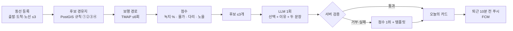

# 샛길 Server

[](https://github.com/dandithon-grip/server/actions/workflows/ci.yml)


> **출퇴근길 걷는 구간 하나만 바꿔, 결심 없이 자연을 지나가게 하는 서비스.**
> 동선을 한 번 등록하면 매일 퇴근 전 "오늘의 샛길" 카드 한 장이 도착한다.
> 2026 단디톤 · 팀 기회는그립감이좋다 · [프론트 저장소](https://github.com/dandithon-grip/front)

---

## 한눈에 보기



| 단계 | 누가 | 무엇을 |
| --- | --- | --- |
| 길 만들기 | **규칙** | 평소 동선에서 걷는 구간만 떼어, 공원·하천 가장자리를 스치는 경로를 만든다 |
| 숫자 | **규칙** | 녹지 비율, 더 걸리는 시간, 노을 방향은 전부 계산값이다 |
| 오늘의 한 곳 | **LLM** | 후보 3개와 날씨·일몰·계절을 보고 하나를 고르고 두 문장을 쓴다 |
| 안전장치 | **서버** | 후보 밖 선택, 입력에 없는 장소명, 계절 상태 단정은 거부하고 템플릿으로 대체한다 |

틀리면 안 되는 숫자는 모델에게 맡기지 않는다. AI는 고르고 말하기만 한다.

---

## 숫자로 보는 품질

| 항목 | 값 | 근거 |
| --- | --- | --- |
| 테스트 | **389 passed** | `uv run pytest`, PR마다 CI (ruff · ruff format · mypy strict · pytest) |
| 카드 LLM 평가 | **기대값 충족 98%** | 24개 상황 × 2회, 서비스와 같은 검증 코드로 채점. 1회차 88% → 4회차 98% · [docs/eval](docs/eval/README.md) |
| 모델 선정 | Opus 98% · Haiku 88% | 같은 평가 세트로 비교, 비용 약 25배 차. 호출이 하루 1회라 품질을 택함 |
| 입력 토큰 | **2,392 → 1,694 (−29%)** | 출력 스키마가 입력 토큰으로 청구되는 점을 실측으로 발견, 스키마 재설계 + 입력 압축 · [docs/eval](docs/eval/README.md#토큰-59) |
| 카드 조회 | 6.8초 → **0.6초** | (날짜 · 노선 · 취향) 캐시, 두 번째부터 LLM 호출 0 |
| 경로 점수 DB 조회 | 경로당 4회 → 2회 | 녹지 · 하천 · 종류 집계를 쿼리 하나로 |

카드마다 입력·출력 토큰과 응답 시간을 저장한다. 평가 세트 밖에서 품질이 흔들리면 바로 보인다.

---

## 기술 스택

| 영역 | 선택 | 이유 |
| --- | --- | --- |
| API | Python 3.12 · FastAPI · Pydantic v2 | 전부 async. 데코레이터가 곧 OpenAPI 명세 |
| DB | Supabase Postgres + **PostGIS** · SQLAlchemy 2.0 async · Alembic | 녹지 비율은 경로 선을 따라 30m 버퍼로 실측. 공원은 동선에서 가장 가까운 **경계점**을 경유지로 |
| 인증 | Supabase Auth JWT (JWKS 검증) | 가입·로그인 API 없음. 서버는 토큰 검증만 |
| 외부 API | TMAP(보행) · ODsay(대중교통) · 기상청 · 에어코리아 · LLM · 비전 | 전부 `app/clients/` 래퍼. 실패는 한 종류의 예외로 |
| 알림 | FCM 웹 푸시 | 퇴근 10분 전 카드 생성 후 하루 1회 |
| 품질 | uv · ruff · mypy strict · pytest | 재현 테스트를 먼저 커밋하고 고친다 |
| 배포 | Railway (main 머지 시 자동) | [docs/deploy.md](docs/deploy.md) |

쓰지 않는 것: Redis, 메시지 큐, 벡터 DB, 임베딩, RAG, 파인튜닝. 하루 한 장을 만드는 데 필요 없다.

---

## 구조

```
app/
  main.py              앱 생성 · 라우터 · 예외 핸들러
  core/                설정 · DB 세션 · JWT · 예외 (Spring 의 global/)
  domain/              도메인마다 router · service · schemas · models 네 파일
    user/              사용자 upsert, 태그 가중치
    commute/           출퇴근 동선, 정류장, 탑승 계획 ≤3
    route/             경유지 규칙 · TMAP · 점수 · 대체 로직 4단계 · 전체 여정 조립
    card/              오늘의 카드 (LLM 선택 + 검증 + 템플릿 폴백 + 캐시)
    feedback/          별점 1~5 → 태그 가중치 (별점−3)×0.1
    record/            사진 기록, 비전 AI 계절·단계 제안
    notification/      FCM 기기 등록 · 퇴근 알림
  clients/             외부 API 래퍼 (tmap · odsay · kma · airkorea · llm · fcm · supabase)
scripts/               시드 · OSM 녹지 적재 · 자동 Place 추출 · 카드 LLM 평가
docs/                  명세 · 평가 기록 · 배포 · 알림 · 데이터
tests/                 도메인별 API · 지리 계산 단위 테스트 (외부 API 는 가짜 클라이언트)
```

도시 이름은 코드에 없다. 모든 지리 조회는 `city` 파라미터를 받고, 녹지(OSM) · 보행(TMAP) · 대중교통(ODsay)은 전국 데이터라 도시 추가는 데이터 적재와 설정이다.
좌표는 본인 응답 외에는 내보내지 않는다. 다른 사용자 응답 · 로그 · LLM 프롬프트에 좌표를 넣지 않는다.

---

## API

인증이 필요한 API 는 `Authorization: Bearer {Supabase access token}`. 둘러보기(게스트)는 데모 카드만 본다.
Swagger: `http://localhost:8000/docs`

| 메서드 | 경로 | 설명 |
| --- | --- | --- |
| GET | `/users/me` | 내 정보 (최초 호출 시 생성) |
| PUT · GET | `/commutes/me` | 출퇴근 동선 저장 · 조회 (교통수단 · 노선 ≤3 · 기본 취향) |
| GET | `/stations` | 노선 정류장 목록 |
| POST | `/transit/routes` · `/transit/routes/parse` | 대중교통 경로 후보 검색 · ODsay 결과 해석 |
| POST | `/commutes/me/routes` | 샛길 생성 (`wait=false` 면 202 후 백그라운드) |
| GET | `/commutes/me/routes/status` | 생성 진행 상태 |
| GET | `/commutes/me/routes` | 샛길 후보 · 전체 여정 조각 |
| GET | `/cards/today` | 오늘의 카드 (`ride_id` · `preference` 별 캐시) |
| GET | `/cards/demo` | 둘러보기 데모 카드 |
| POST | `/cards/today/push` | 오늘의 카드를 지금 알림으로 |
| POST | `/feedback` | 걷고 나서 별점 1~5 |
| GET · DELETE | `/users/me/tag-weights` | 태그 가중치 조회 · 초기화 |
| POST | `/records/suggest` | 사진의 계절 · 단계 제안 (비전 AI) |
| POST · GET | `/records` | 기록 저장 · 목록 |
| PUT · DELETE | `/users/me/push-tokens` | 알림 기기 등록 · 해제 |
| POST | `/users/me/push-tokens/test` | 테스트 알림 |

에러 응답은 한 가지 모양이다: `{ "message": "..." }`

---

## 실행

```bash
# 1. 로컬 PostGIS
docker compose up -d

# 2. 의존성
uv sync

# 3. 환경변수 (.env.example 복사 후 채운다. 키 값은 저장소 어디에도 쓰지 않는다)
cp .env.example .env

# 4. 마이그레이션 + 서버
uv run alembic upgrade head
uv run uvicorn app.main:app --reload

# 5. 시드 (순서대로, 여러 번 실행해도 결과가 같다)
uv run python -m scripts.seed_stations          # 정류장
uv run python -m scripts.seed_places            # 큐레이션 자연 지점 30곳
uv run python -m scripts.seed_demo              # 데모 계정 + 동선 + 경로 사전 계산
uv run python -m scripts.derive_places daegu    # OSM 녹지에서 자연 지점 자동 추출 (docs/data/osm.md 적재 뒤)
```

```bash
# 테스트 · 린트 · 타입
uv run pytest
uv run ruff check . && uv run ruff format --check . && uv run mypy app scripts

# 카드 LLM 평가 (LLM_API_KEY 필요, 결과는 docs/eval/cards.md)
uv run python -m scripts.eval_cards --repeat 2
```

---

## 문서

| 문서 | 내용 |
| --- | --- |
| [docs/spec.md](docs/spec.md) | 기능 · 요구사항 명세 v3. **여기 없는 기능은 만들지 않는다** |
| [docs/eval/README.md](docs/eval/README.md) | 카드 LLM 평가 방법, 4회차 개선 기록, 토큰 전후 |
| [docs/transit-web.md](docs/transit-web.md) | 대중교통 노선 · 전체 여정 그리기 · 생성 상태 폴링 (프론트 연동) |
| [docs/notification.md](docs/notification.md) | FCM 웹 푸시 설정과 확인 절차 |
| [docs/deploy.md](docs/deploy.md) | Railway · Supabase 배포, Storage 버킷, 장애 대처 |
| [docs/data/osm.md](docs/data/osm.md) | OSM 녹지 데이터 적재 |
| [.claude/CLAUDE.md](.claude/CLAUDE.md) | 코드 컨벤션 · 패키지 규칙 · Git 규칙 |

---

## Git 규칙

- `main` 배포 · `develop` 통합 · `feat/#이슈` `fix/#이슈` `docs/#이슈`
- 결함은 **재현 테스트를 먼저 `test:` 로 커밋**하고 `fix:` 로 고친다. 새 기능도 같은 순서
- 커밋은 한국어 한 줄: `{타입}: {무엇을} - {왜 또는 측정 결과} (#이슈)`. 숫자는 실측값만
- 키 값은 코드 · 테스트 · 로그 · 커밋 메시지 어디에도 쓰지 않는다
